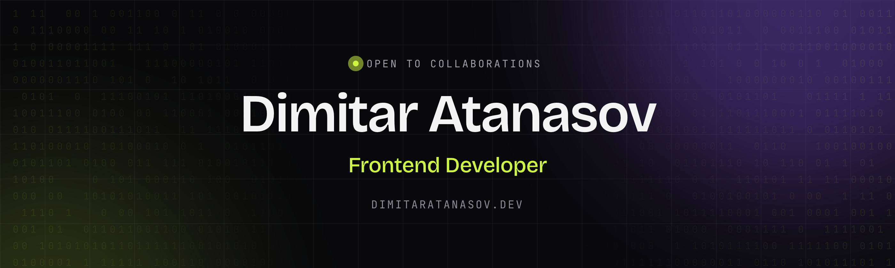

 

## Hi, I'm Dimitar 👋

Frontend developer based in Ljubljana, Slovenia. I build web and mobile interfaces, mostly with React and Next.js, and with Vue, Angular, React Native and Flutter when a product calls for them.

These days I work on original in-house games at Playlink: real-time, animation-heavy React apps built on a shared game framework, mixing DOM and canvas rendering. Before that I was the first frontend hire at Tech Wave Entertainment, where I built a large consumer platform from scratch and mentored three developers along the way.

**What I care about**

- Interfaces that feel fast and polished: snappy interactions, thoughtful motion, accessible markup.
- Code that is easy for the next person to pick up.
- Working side by side with designers and backend developers, not handing things over a wall.

## Toolbox

## Highlights

| | |
| --- | --- |
| 🎮 **Original games** | Ten real-time games (Plinko, Mines, Blackjack, Hi-Lo, Dice, Limbo, Wallet Reloads, Lootbox Trends and more) on a shared game framework and component library I built. |
| 🏗️ **Platform from scratch** | First frontend hire on a Next.js product that grew to 250,000+ active users, with the back office to run it. |
| 📱 **Mobile** | The official East Gate Mall Skopje app in Flutter, live on the App Store and Google Play, plus React Native work for an internal warehouse system. |
| 🤝 **Mentoring** | Three developers onboarded, paired with and reviewed, all three promoted. |

## GitHub

Open to collaborations and interesting projects. Say hi.

